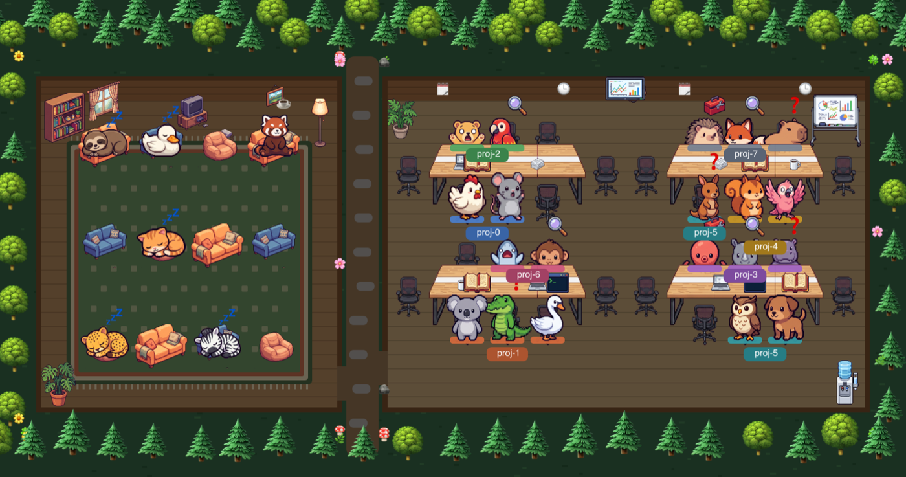

# Agent Grove 🌲

แอป macOS ที่แสดงการทำงานของ AI agent ในเครื่องเป็นสัตว์ pixel art ในกระท่อมกลางป่า



- **🛋️ ห้องนั่งเล่น (ซ้าย)** สัตว์หลายชนิดนั่งเล่น นอน อ่านหนังสือ เล่นเกม ลุกสลับโซฟา ที่นั่งกระจายทั่วห้องและจัดผังใหม่ทุก ~3 นาที และมีตัวใหม่เดินเข้า-ออกจากป่าเป็นระยะ
- **🏢 ห้องทำงาน (ขวา)** เมื่อ agent เริ่มทำงาน จะสุ่มสัตว์หนึ่งตัวจากห้องนั่งเล่นเดินไปนั่งโต๊ะ คนโปรเจกต์เดียวกันนั่งติดกันพร้อมสีและป้ายชื่อโปรเจกต์ ถือของตามเครื่องมือที่ใช้อยู่ (terminal, หนังสือ, แว่นขยาย, กล่องเครื่องมือ …)
- **ลูกสัตว์** = subagent ที่ agent เรียกขึ้นมา นั่งข้างตัวหลัก แล้วเดินออกไปเมื่องานจบ
- **⏳ รอ command** เครื่องมือ (เช่น build/test) รันค้างเกิน 5 วินาที: ตัวละครลุกเดินไปยืนรอที่พื้นโล่งในห้อง แล้วกลับมานั่ง วนจนเสร็จ + นาฬิกาทราย + คำสั่งและเวลาในรายชื่อ
- **❗ รออนุญาต / ❓ รอคำสั่ง** แสดงบนตัวละคร และสรุปบน menu bar (`🐾 2+1 ⏳1 ❗1`)
- **โหมดมืด** = ป่ากลางคืนมีหิ่งห้อย

## แหล่งข้อมูล (อ่านอย่างเดียว ไม่ส่งข้อมูลออกนอกเครื่อง)

| ไฟล์ | ใช้ทำอะไร |
|---|---|
| `~/.claude/sessions/*.json` | Claude Code session ที่เปิดอยู่ (busy/idle, โฟลเดอร์) |
| `~/.claude/projects/<โปรเจกต์>/<session>/subagents/` | subagent ที่กำลังทำงาน + เครื่องมือล่าสุด |
| `~/Library/Application Support/orca/agent-hooks/last-status.json` | สถานะจากแอป Orca (ถ้ามี): รออนุญาต/รอคำสั่ง, ชื่อเครื่องมือ, prompt ล่าสุด |

agent ใน git worktree เดียวกันถูกนับเป็นโปรเจกต์เดียวกัน

## Build

ต้องมี Xcode Command Line Tools (`xcode-select --install`) และ macOS 14 ขึ้นไป

```sh
./build.sh
open "build/Agent Grove.app"     # หรือลากไปไว้ใน /Applications
```

ครั้งแรก macOS อาจถามสิทธิ์เข้าถึงข้อมูลของแอปอื่น (Orca) ให้กด **Allow**

## ทรัพยากร

SwiftUI + Core Animation ล้วน ไม่มี WebKit / ไม่มี dependency — CPU ~0–2%, RAM ~30–40 MB
อ่านไฟล์สถานะทุก 2 วินาที (นอก main thread) และหยุดแอนิเมชันเมื่อหน้าต่างถูกปิดหรือบังมิด

## เพิ่มสัตว์ / ของตกแต่ง

ภาพทั้งหมดอยู่ใน `Sprites/` แอปหยิบสัตว์ทุกชนิดจากชื่อไฟล์อัตโนมัติ ไม่ต้องแก้โค้ด:

| ไฟล์ | ท่า |
|---|---|
| `<ชื่อ>_stand.png` | ยืน (จำเป็น) |
| `<ชื่อ>_walk.png`, `<ชื่อ>_walk2.png` | ก้าวเท้าสลับตอนเดิน |
| `<ชื่อ>_sit.png`, `<ชื่อ>_sleep.png` | นั่ง / นอน ในห้องนั่งเล่น |
| `<ชื่อ>_alert.png` | ตกใจ (รออนุญาต) |
| `baby_<ชื่อ>_stand.png` | ลูกสัตว์ ใช้เป็น subagent |

ท่าที่ไม่มีจะใช้ท่ายืนแทน

### โหมดตัวละคร

สลับได้จากปุ่มมุมขวาบนของหน้าต่าง หรือเมนูบน menu bar (แอปจำโหมดที่เลือกไว้)

| โหมด | โฟลเดอร์ภาพ |
|---|---|
| 🐾 สัตว์รวม | `Sprites/` |
| 🐕 สุนัข | `Sprites/dogs/` — 32 สายพันธุ์ + ลูกหมา 6 ตัว (ตั้งชื่อไฟล์แบบเดียวกัน) |

ฉาก เฟอร์นิเจอร์ และของในมือใช้ `Sprites/` ร่วมกันทุกโหมด

### ตัดภาพจาก sprite sheet

สร้างภาพพื้นสีม่วงชมพูล้วน `#FF00FF` จัดเป็นตาราง (เช่น 6 ท่า × 4 สัตว์) แล้ว:

```sh
python3 tools/cut_magenta.py sheet.jpeg Sprites \
  cat_{stand,walk,walk2,sit,sleep,alert} dog_{stand,walk,walk2,sit,sleep,alert} ...
```

- ชื่อเรียงตามลำดับการอ่านในภาพ (ซ้าย→ขวา, บน→ล่าง), `-` = ข้ามชิ้นนั้น
- ตัวติดกันข้ามช่อง/มีแสงแยกชิ้น → ใส่ `--grid=6x4` ให้ตัดตามช่องตาราง
- ต้องมี Pillow (`pip3 install pillow`)
- `tools/cut_all.sh` คือคำสั่งที่ใช้ตัดชุดภาพปัจจุบัน (อ้างไฟล์ใน `~/Downloads`) ใช้เป็นตัวอย่าง

ต้องการ Pillow เฉพาะตอนตัดภาพ ตัวแอปไม่ต้องใช้

### ตรวจหน้าตาโดยไม่ต้องเปิดหน้าต่าง

```sh
AGENT_GROVE_SNAPSHOT=/tmp/shot.png "build/Agent Grove.app/Contents/MacOS/AgentGrove"                  # ข้อมูลจริง
AGENT_GROVE_SNAPSHOT=/tmp/demo.png AGENT_GROVE_DEMO=1 "build/Agent Grove.app/Contents/MacOS/AgentGrove" # ข้อมูลจำลอง 24 ตัว
AGENT_GROVE_LIST=1 "build/Agent Grove.app/Contents/MacOS/AgentGrove"                                       # พิมพ์สถานะที่อ่านได้
AGENT_GROVE_SNAPSHOT=/tmp/dogs.png AGENT_GROVE_MODE=dogs "build/Agent Grove.app/Contents/MacOS/AgentGrove"  # โหมดสุนัข
AGENT_GROVE_SNAPSHOT=/tmp/r.png AGENT_GROVE_REARRANGE=1 "build/Agent Grove.app/Contents/MacOS/AgentGrove"   # ผังห้องนั่งเล่นรอบถัดไป
AGENT_GROVE_SNAPSHOT=/tmp/p.png AGENT_GROVE_DEMO=1 AGENT_GROVE_PACE=0.45 "build/Agent Grove.app/Contents/MacOS/AgentGrove"  # ท่าเดินรอ command ณ เวลา 0–1
```

## โครงสร้าง

```
main.swift        แอปทั้งหมด: อ่านสถานะ, จัดที่นั่ง/เส้นทางเดิน, วาดฉากด้วย Core Animation, หน้าต่าง SwiftUI + menu bar
build.sh          compile + ประกอบ .app + ไอคอน + ad-hoc codesign
icon.swift        วาดไอคอนแอป
Sprites/          ภาพ pixel art (สร้างด้วย Gemini)
tools/            สคริปต์ตัด sprite sheet
```
